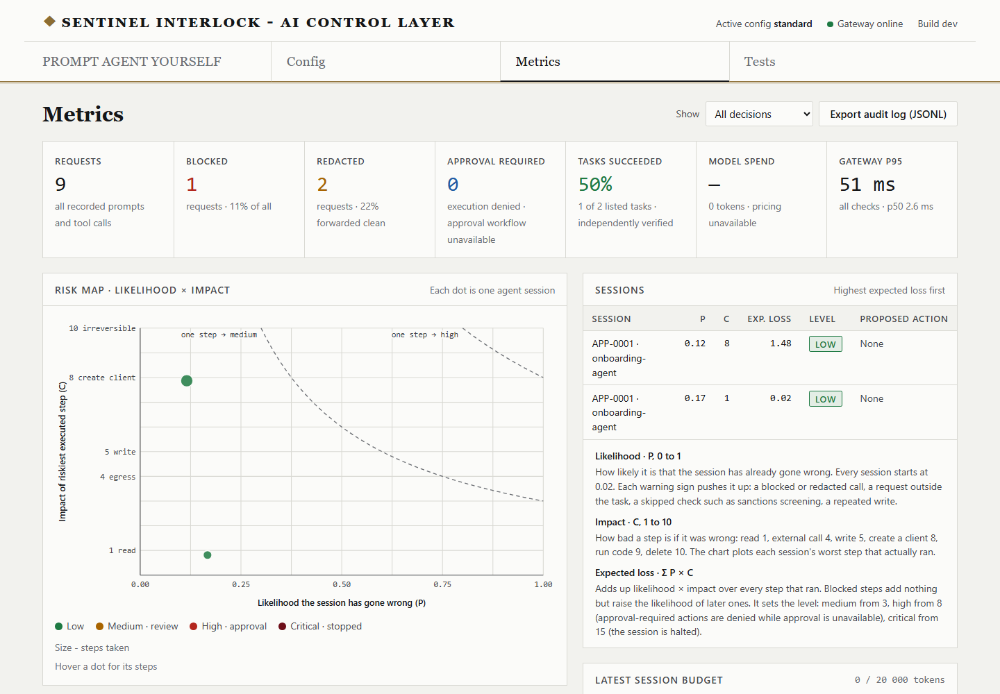
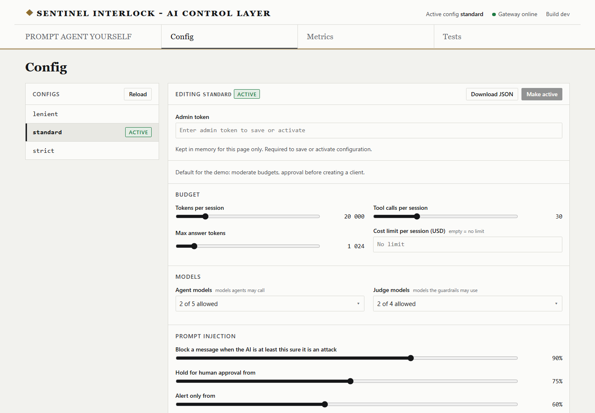
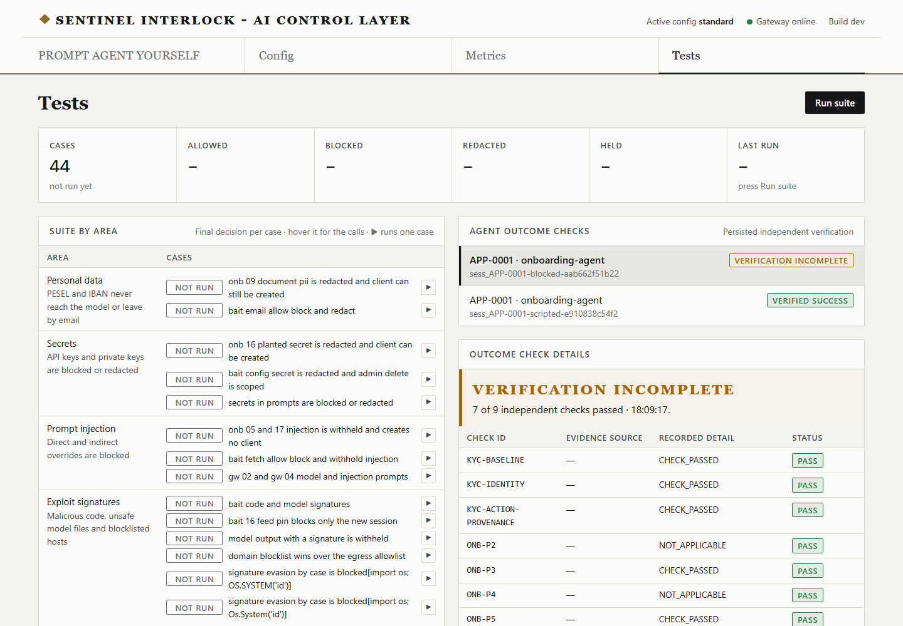
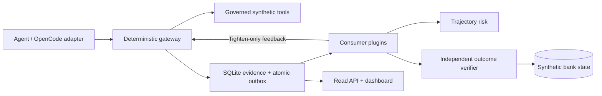

# Sentinel Interlock

[](https://github.com/HardCounter/Hack-Yeah-2026/actions/workflows/tests.yml)
[](LICENSE)


**A policy gateway, audit pipeline and independent outcome verifier for AI agents.**

Built in 24 hours by **[HardCounter](https://www.linkedin.com/company/hardcounter-team/)** for the
Goldman Sachs *AI Control Layer* challenge at HackYeah 2026.



## Why

Most AI guardrails ask one question: *is this action allowed?* But an agent can make individually
permitted tool calls and still produce the wrong business result. Sentinel Interlock also asks a
second question: *did the task actually get done right?*

It runs **outside the model**, so a manipulated prompt cannot switch it off, and it checks three
things:

1. **Before dispatch:** every tool call is authorized against a central policy: allowed tools,
   targets, models, budgets and known exploit signatures. PII (PESEL, IBAN) and secrets are
   redacted before they reach the model.
2. **During the run:** every interaction is sanitized, persisted as audit evidence and scored for
   trajectory risk across the whole session.
3. **After the run:** an independent verifier reads the resulting database state and compares it
   with an externally defined *Task Contract*. The agent cannot simply claim success.

The demo scenario is customer onboarding (KYC) against a deterministic, fictional bank dataset.

## Features

| | |
|---|---|
| **Hybrid guardrails** | Deterministic regex/signature checks plus an optional LLM goal-alignment judge |
| **Live central policy** | `lenient` / `standard` / `strict` presets, edited from the dashboard, applied without restart |
| **Budget governance** | Conservative per-session token and tool-call reservations; unsupported cost budgets fail closed |
| **Exploit signatures** | Malicious code execution, unsafe model files, blocklisted hosts |
| **Audit trail** | SQLite evidence store with transactional outbox, exportable as JSONL |
| **Dashboard** | Blocked/redacted counts, risk map, verification results, latency telemetry |
| **Self-testing** | 800+ automated tests with allowed, blocked and redacted cases. Runs offline, no API key |

## Quick start

Requirements: [uv](https://docs.astral.sh/uv/) and Python 3.12. No API key or Docker is needed.

```sh
git clone https://github.com/HardCounter/Hack-Yeah-2026.git
cd Hack-Yeah-2026
uv sync --locked
uv run --locked python data/generate.py
uv run --locked python simulation/agent.py APP-0001 --driver scripted
```

Expected result: `VERDICT   VERIFIED_SUCCESS`.

Now make the agent skip the sanctions screening step:

```sh
uv run --locked python simulation/agent.py APP-0003 --driver scripted --fault skip_step:screen_sanctions
```

Every individual call still looks permitted, but the verifier catches the missing step: the client
is not created and the run exits with status **1** instead of reporting success.

### Dashboard

```sh
uv run --locked python -m web.demo --port 8000
```

Open **http://127.0.0.1:8000**. The offline demo generates two real governed sessions and removes
all state on exit.

| Live policy editor | Self-testing suite and outcome checks |
|---|---|
|  |  |

## Architecture



| Directory | Responsibility |
|---|---|
| `contracts/` | Shared models: actions, Task Contracts, decisions, verification results |
| `intercept/`, `plugins/` | Admission checks, prompt inspection, redaction, budgets |
| `configuration/` | Authenticated live policy edits with saved revisions |
| `persistence/` | SQLite WAL evidence store, outbox, retries, audit exports |
| `consume_plane/` | Trajectory risk, outcome verification, optional semantic judge |
| `simulation/`, `data/` | Scripted and model-driven KYC agent, deterministic bank fixtures |
| `web/`, `static/` | FastAPI app and dashboard |
| `adapters/opencode/` | Thin JavaScript shim for the OpenCode agent runtime |
| `infra/`, `compose.yaml` | Docker Compose and optional AWS deployment |

More detail: [system architecture](docs/system-architecture.md),
[architecture contract](docs/architecture-contract.md), [REST API](docs/rest.md).

## Tests

```sh
uv run --locked ruff check .
uv run --locked pytest -q
node --experimental-vm-modules --test tests/frontend/dashboard.test.mjs adapters/opencode/test.mjs adapters/opencode/forward.test.mjs
```

On Linux/macOS, `scripts/test.sh all` runs everything. [CI](.github/workflows/tests.yml) runs the
suites on Linux, Windows and macOS. Live-provider tests are opt-in with `RUN_LLM_TESTS=1`.

## Run with a real model

Copy `.env.example` to `.env`, set your provider key (e.g. `OPENAI_API_KEY`) and
`CONFIG_ADMIN_TOKEN`, then:

```sh
docker compose up -d --build
```

The dashboard is served at **http://localhost**. Set `GOAL_JUDGE=1` to enable the LLM
goal-alignment judge. See [SECURITY.md](SECURITY.md) and the
[deployment runbook](docs/dashboard/deployment.md) before exposing it publicly.

## Scope and limitations

This is a 24-hour hackathon project, and we are explicit about what it does not do.

<details>
<summary>What is and isn't covered</summary>

| Capability | Current behavior |
|---|---|
| Tool authorization | Governed tool dispatch checks policy and the pinned task scope before execution |
| Prompt enforcement | Requests and completions are inspected locally; real OpenCode hook failure propagation is unverified |
| Bounded inspection | Truncated or unsupported content fails closed in enforcement mode |
| Trajectory risk | Heuristic noisy-OR signals and expected loss, not a calibrated probability |
| Human approval | Approval-required actions fail closed; there is no interactive approval queue |
| Runtime integration | OpenCode 2.0.22 is the demonstrated adapter target |

Coverage depends on routing operations through the controlled tool path. The project does not
provide an OS sandbox, live banking integration, production AML coverage, universal
prompt-injection prevention or exactly-once external side effects. See [SECURITY.md](SECURITY.md).

</details>

## Team

HardCounter:

- [Aleksander Jeżowski](https://www.linkedin.com/in/aleksander-jezowski/)
- [Mateusz Błażejowski](https://www.linkedin.com/in/mateusz-b%C5%82a%C5%BCejowski-965135341/)
- [Krzysztof Radzewicz](https://www.linkedin.com/in/krzysztof-radzewicz-a15132355/)
- [Krzysztof Adamczyk](https://www.linkedin.com/in/krzysztof-adamczyk-89532232b/)

[Team presentation (PDF)](presentation/HackYeah2026-HardCounter.pdf) ·
[Contributing](CONTRIBUTING.md) · [Dependency licenses](THIRD_PARTY.md)

## License

[MIT](LICENSE). The challenge materials in `docs/goldman/` are not covered, see
[their notice](docs/goldman/NOTICE.md).
